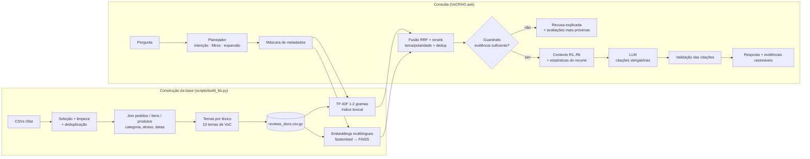

# Voice of Customer Intelligence com RAG — Olist

Solução do **Tech Challenge – Fase 4 (IA para Devs / FIAP)**: um sistema de *Retrieval-Augmented Generation* que transforma ~39 mil avaliações escritas de clientes do [Brazilian E-Commerce Public Dataset by Olist](https://www.kaggle.com/datasets/olistbr/brazilian-ecommerce) em uma base de conhecimento consultável em linguagem natural. Cada resposta é **fundamentada em avaliações reais, citadas e rastreáveis** (`review_id`). Quando a base não tem evidência suficiente, o sistema **se recusa a responder**.

```
Pergunta → Planejamento (intenção, filtros, expansão) → Busca híbrida (TF-IDF lexical + embeddings/FAISS)
        → Fusão RRF + rerank por tema/polaridade → Guardrails de evidência → Contexto [R1..Rk] + estatísticas
        → LLM com citações obrigatórias → Validação das citações → Resposta + evidências
```

---

## Sumário
1. [Problema de negócio](#1-problema-de-negócio)
2. [Arquitetura](#2-arquitetura)
3. [Preparação da base](#3-preparação-da-base-de-conhecimento)
4. [Pipeline RAG](#4-pipeline-rag)
5. [Respostas fundamentadas e tratamento de falta de evidência](#5-respostas-fundamentadas-e-falta-de-evidência)
6. [Metadados (desafio adicional)](#6-metadados-desafio-adicional)
7. [Avaliação](#7-avaliação)
8. [Instalação e execução](#8-instalação-e-execução)
9. [Exemplos](#9-exemplos-de-perguntas-e-respostas)
10. [Decisões técnicas e trade-offs](#10-decisões-técnicas-e-trade-offs)
11. [Estrutura do repositório](#11-estrutura-do-repositório)

---

## 1. Problema de negócio

Gestores de e-commerce têm a nota (1–5) de cada pedido, mas os **motivos** de satisfação e insatisfação estão no texto livre. Ler milhares de comentários não escala. A solução permite perguntas como *"Quais reclamações sobre entrega aparecem com mais frequência?"* e devolve: (a) uma síntese, (b) **as avaliações que a sustentam** e (c) **o tamanho do padrão no corpus**, por exemplo: "~28% das avaliações com nota 1–3 relatam produto não recebido ou incompleto".

## 2. Arquitetura



| Camada | Tecnologia | Por quê |
|---|---|---|
| Dados | pandas | ETL tabular simples, 100 mil linhas cabem em memória |
| Índice lexical | scikit-learn `TfidfVectorizer` (1–2 gramas, sem acento) | Termos exatos de domínio ("correios", "faltando", "estorno") e expressões ("antes do prazo") |
| Embeddings | `fastembed` + `paraphrase-multilingual-MiniLM-L12-v2` (384d) | Multilíngue (PT-BR), roda em CPU via ONNX sem PyTorch, ~220 MB |
| Banco vetorial | FAISS `IndexFlatIP` + `IDSelectorBatch` | Busca exata por cosseno em 39k vetores (milissegundos); filtro por metadados dentro do índice |
| Geração | Anthropic (Claude) ou qualquer API compatível com OpenAI (OpenAI, Ollama, Groq) | Provedor plugável; modo **extrativo** sem LLM para rodar sem chave e para testes |
| Interface | Streamlit + CLI | Demonstração interativa e reprodutibilidade |

## 3. Preparação da base de conhecimento

Implementada em [`src/voc/prep.py`](src/voc/prep.py). Os números abaixo vêm de `data/processed/build_stats.json`.

| Etapa | Decisão | Justificativa | Efeito |
|---|---|---|---|
| **Seleção** | Só avaliações com texto (título e/ou mensagem) | O objetivo é a voz do cliente; nota sem texto não é evidência textual | 100.000 → 41,7 mil com mensagem |
| **Valores ausentes** | Título ausente (88%) → usa só a mensagem; mensagem ausente → usa o título; ambos ausentes → descarta. Categoria ausente → `desconhecida`; pedido não entregue → atraso `NaN` (não "no prazo") | Não inventar valores; distinguir "não se aplica" de "falso" | 514 sem categoria |
| **Limpeza** | Normalização Unicode NFKC, quebras de linha → espaço, pontuação repetida reduzida (`!!!!!!` → `!!!`), espaços colapsados. **Sem** lematização nem remoção de stopwords no texto armazenado | O texto armazenado é a **evidência exibida ao gestor** e deve ser fiel ao cliente. Normalização agressiva (minúsculas, sem acento) só na cópia `text_fold`, usada na busca lexical | — |
| **Texto informativo** | Mínimo de 10 caracteres e 2 palavras | "ok", "bom" e "." não sustentam insights | 60.627 descartadas (incluindo as vazias) |
| **Duplicatas** | Mesmo `review_id`, ou mesmo texto no mesmo pedido | O dataset repete avaliações em pedidos com vários itens/vendedores | 304 removidas |
| **Documento** | 1 avaliação = 1 documento (título + mensagem), **sem chunking** | Mediana de 54 caracteres, máximo de 208: cada avaliação já é uma unidade semântica atômica; fatiar destruiria o contexto | **39.069 documentos** |
| **Metadados** | Nota, sentimento (1–2 / 3 / 4–5), data, ano-mês, status do pedido, dias de entrega, **atraso vs. prazo estimado**, categoria (majoritária no pedido, PT e EN), nº de itens, valor e frete | Filtros e análises contextualizadas (ver seção 6) | 10,3% das avaliações vêm de pedidos entregues com atraso |
| **Temas** | 10 temas de VoC por léxico/regex (atraso, não recebido, entrega rápida, qualidade/defeito, produto divergente, atendimento, troca/reembolso, embalagem, preço/frete, satisfação) | Quantificar padrões **no corpus inteiro**, não só nos k documentos recuperados; também usado no rerank | — |
| **Embeddings** | Modelo multilíngue sobre o texto original; vetores L2-normalizados | Similaridade de cosseno = produto interno | 39.069 × 384 |
| **Armazenamento/indexação** | `reviews_docs.csv.gz` (documentos + metadados), TF-IDF (`.npz` + vetorizador `joblib`), FAISS (`dense.faiss`) | Arquivos locais, versionáveis e reprodutíveis; sem servidor | ~10 MB sem o FAISS |

> **Datas:** o código aceita ISO (`2018-01-18 00:00:00`, formato do Kaggle) e `M/D/AAAA H:M` (aparece quando o CSV é re-salvo no Excel).

## 4. Pipeline RAG

### 4.1 Transformação da pergunta ([`query.py`](src/voc/query.py))
O planejador extrai da pergunta, sem usar LLM (rápido, determinístico e auditável):
- **Intenção:** negativa ("problemas", "reclamações", "insatisfeitos"), positiva ("elogiam", "valorizam") ou neutra.
- **Filtros:** nota explícita ("nota 1", "notas 1 e 2"), nota implícita ("nota baixa" → 1–2; intenção negativa → 1–3; positiva → 4–5), **categoria** (nome ou apelido: "celular" → `telefonia`; nomes específicos têm prioridade sobre apelidos genéricos), **ano** e **entrega com atraso**.
- **Expansão lexical:** "entrega" → `prazo chegou atraso demora correios transportadora…` (só no índice lexical; o denso já captura sinônimos).
- **Termos-chave de assunto:** palavras que **precisam** aparecer nas evidências. Ficam de fora palavras de intenção ("problemas", "elogiam") e substantivos genéricos ("loja", "produto"). São usados nos guardrails.

Todos os filtros aplicados aparecem na resposta, para que o gestor saiba qual recorte foi analisado. Na interface, cada um pode ser sobrescrito.

### 4.2 Recuperação semântica ([`retriever.py`](src/voc/retriever.py))
1. **Máscara de metadados** aplicada **antes** da busca: o FAISS só pesquisa os IDs permitidos (`IDSelectorBatch`).
2. **Busca híbrida:** TF-IDF (consulta expandida) e embeddings (pergunta original) retornam 40 candidatos cada.
3. **Fusão RRF** (*Reciprocal Rank Fusion*, k=60): combina rankings sem precisar calibrar escalas de score diferentes.
4. **Rerank leve:** ×1,3 se o documento tem o tema da pergunta; ×0,6 se a polaridade contradiz a intenção ("entrega sem problemas" não é evidência de problema de entrega); ×0,8 para textos com menos de 4 palavras.
5. **Remoção de redundância:** textos idênticos de clientes diferentes viram 1 evidência com o contador "texto repetido por N clientes", que funciona como sinal de recorrência.

**Perguntas panorâmicas** ("quais os principais problemas?", sem assunto específico) usam **recuperação estratificada por tema**: identifica os 4 temas mais frequentes no recorte e busca os melhores exemplos de cada um. Sem isso, a busca ancorava na palavra literal "problemas" e trazia frases como "entrega sem problemas".

### 4.3 Seleção e construção do contexto
São enviadas ao LLM até 12 avaliações **relevantes** (acima do limiar lexical ou denso), cada uma assim:

```
[R3] nota 1 | utilidades_domesticas | 2018-08-19 | entrega: atrasou 6d
"Paguei frete e não recebi o produto. Fui até os Correios, tinham devolvido…"
```

Também vão as **estatísticas do recorte**, calculadas sobre *todas* as avaliações filtradas: distribuição de notas, % com atraso, % por tema e categorias mais frequentes. Isso permite ao LLM falar de frequência ("aparece em ~12% das avaliações negativas") sem extrapolar a partir de 12 exemplos.

### 4.4 Geração ([`generator.py`](src/voc/generator.py))
O prompt de sistema exige: usar **somente** as avaliações e estatísticas fornecidas; citar `[R#]` em toda afirmação; não inventar números; diferenciar "várias avaliações" de "uma avaliação"; e responder com o token `EVIDENCIAS_INSUFICIENTES` quando o contexto não sustentar a resposta. O formato de saída é: resposta direta → padrões com citações → limitações.

## 5. Respostas fundamentadas e falta de evidência

Há defesas **antes** e **depois** da geração ([`pipeline.py`](src/voc/pipeline.py)):

| Situação | Como é detectada | Status retornado |
|---|---|---|
| Filtro sem dados ("avaliações de 2015") | recorte com 0 avaliações | `sem_dados_no_filtro` |
| Pergunta fora do domínio ("capital da França", "bitcoin") | poucas evidências, ou termos-chave não cobertos, **e** nenhum termo do domínio de e-commerce | `fora_do_escopo` |
| Assunto do domínio sem registro na base ("aplicativo de realidade virtual") | **suporte por avaliação:** menos de 3 avaliações contêm, *sozinhas*, ao menos metade dos termos-chave. Evita aceitar "virtual" de "loja virtual" + "realidade" de outra avaliação | `evidencia_insuficiente` |
| Evidências fracas | menos de 3 evidências acima do limiar de relevância | `evidencia_insuficiente` |
| O próprio LLM julga insuficiente | resposta começa com `EVIDENCIAS_INSUFICIENTES` | `evidencia_insuficiente` |
| LLM cita `[R99]`, que não existe | validação pós-geração remove a citação e registra aviso | `ok` + aviso |
| LLM responde sem nenhuma citação | resposta descartada e substituída pela versão extrativa fundamentada | `ok` + aviso |
| LLM fora do ar ou sem chave | fallback automático para o modo extrativo | `ok` + aviso |

Nas recusas, o sistema **não gera texto**: explica o motivo e mostra as avaliações mais próximas para inspeção manual. Toda evidência exibida traz `review_id`, `order_id`, nota, categoria, data e os scores lexical e denso, o que garante rastreabilidade ponta a ponta.

## 6. Metadados (desafio adicional)

| Metadado | Uso | Como melhora a recuperação |
|---|---|---|
| Nota / sentimento | Filtro explícito ou inferido pela intenção | Em "o que os insatisfeitos relatam?", sem filtro, frases positivas com palavras parecidas competem pelo top-k; o filtro elimina esse ruído na origem |
| Categoria | Filtro por nome ou apelido | "elogios em beleza" pesquisa só 2.092 avaliações de `beleza_saude`, em vez de 39 mil |
| Período | Filtro por ano | Análises temporais; ano sem dados → recusa explícita |
| Atraso de entrega (entregue − estimado) | Filtro "pedidos entregues com atraso" + informação no contexto | Liga o relato ao **fato operacional**: o LLM vê que "R3 atrasou 6 dias" |
| Temas | Rerank, estratificação e estatísticas do recorte | Quantifica padrões no recorte inteiro e diversifica o top-k |

## 7. Avaliação

`python scripts/evaluate.py` roda 17 perguntas ([`docs/eval_questions.json`](docs/eval_questions.json)): 11 dentro do escopo (as do enunciado e variações com metadados) e 6 que **devem ser recusadas**. Métricas:

- **Acurácia da decisão responder/recusar**
- **Precisão temática@k:** fração das evidências que pertencem a um tema esperado para a pergunta (proxy de precisão de recuperação, sem rótulo manual)
- **Citações válidas:** respostas com ao menos uma citação, todas existentes no contexto

Resultado com índice TF-IDF e gerador extrativo (determinístico):

| Métrica | Valor |
|---|---|
| Decisão responder/recusar | **17/17 (100%)** |
| Precisão temática média@12 | **0,93** |
| Respostas com citações válidas | **100%** |

> ⚠️ **Limitação honesta:** os limiares foram calibrados olhando esse mesmo conjunto, então o número é otimista. Num teste com 10 perguntas novas (não usadas na calibração), o sistema recusou corretamente "time de futebol" e "previsão do tempo" e respondeu as legítimas. Mas um conjunto rotulado maior, de preferência por outra pessoa do grupo, é o próximo passo. Ao ativar o índice denso, **recalibre** `VOC_DENSE_MIN_SCORE` com o mesmo script.

Testes unitários: `pytest -q`. Cobrem limpeza, temas, filtros, recusas, remoção de citações inválidas, resposta sem citação, token de insuficiência e o índice FAISS com filtro (usando um embedder de hashing, sem baixar modelo).

## 8. Instalação e execução

Requisitos: Python 3.10+ e ~1 GB de disco (dados + modelo de embeddings).

```bash
git clone <URL-do-repo> && cd voc-rag-olist
python -m venv .venv && source .venv/bin/activate   # Windows: .venv\Scripts\activate
pip install -r requirements.txt
cp .env.example .env    # coloque ANTHROPIC_API_KEY (ou OPENAI_API_KEY / Ollama)

# 1) Dados: automático via kagglehub (pede login Kaggle na 1ª vez)...
python scripts/download_data.py
#    ...ou baixe o zip do Kaggle e extraia os CSVs em data/raw/

# 2) Base de conhecimento + índices (TF-IDF ~20 s; embeddings ~5–10 min em CPU)
python scripts/build_kb.py              # híbrido (recomendado)
python scripts/build_kb.py --no-dense   # só lexical, sem baixar modelo

# 3) Usar
streamlit run app.py                                            # interface web
python scripts/ask.py "O que os clientes relatam sobre entrega?" # CLI
python scripts/evaluate.py                                      # métricas
pytest -q                                                       # testes
```

Arquivos usados de `data/raw/`: `olist_order_reviews_dataset.csv`, `olist_orders_dataset.csv`, `olist_order_items_dataset.csv`, `olist_products_dataset.csv`, `product_category_name_translation.csv`.

**Sem chave de LLM?** O sistema roda em modo extrativo (agrupa evidências por tema e cita trechos literais). Para um LLM local e gratuito: `VOC_LLM_PROVIDER=openai`, `VOC_LLM_BASE_URL=http://localhost:11434/v1`, `VOC_LLM_MODEL=llama3.1` (Ollama).

Todas as configurações estão em [`.env.example`](.env.example) e [`src/voc/config.py`](src/voc/config.py).

## 9. Exemplos de perguntas e respostas

O arquivo completo, gerado pelo próprio sistema, está em [`docs/exemplos.md`](docs/exemplos.md) (`python scripts/make_examples.py` regenera com o gerador configurado). Resumo:

| Pergunta | Status | Filtros inferidos | Destaques das evidências |
|---|---|---|---|
| Quais são os principais problemas relatados? | ok | nota 1–3 (14.680 aval.) | não recebido/incompleto (~28% do recorte), troca/reembolso (~12%), atraso (~12%), qualidade/defeito (~11%), produto divergente (~9%) |
| O que relatam sobre problemas de entrega? | ok | nota 1–3 | "Entrega em atraso", "Paguei frete e não recebi… Correios tinham devolvido" |
| O que mais elogiam? | ok | nota 4–5 (24.389 aval.) | satisfação/recomendação (~62%), entrega antes do prazo (~40%), qualidade elogiada, embalagem |
| Elogios em beleza e saúde | ok | nota 4–5; `beleza_saude` | recorte de 2.092 avaliações |
| Problemas em móveis de escritório em 2018 | ok | nota 1–3; `moveis_escritorio`; 2018 | recorte de 168 avaliações: produto incompleto/faltando peça (~31%), defeito ou danificado, pedidos de troca/reembolso, atraso |
| Qual é a capital da França? | **fora_do_escopo** | — | sem geração |
| Aplicativo de realidade virtual da loja | **evidencia_insuficiente** | — | 0 avaliações tratam do assunto |
| Problemas em avaliações de 2015 | **sem_dados_no_filtro** | ano 2015 | base cobre 2016–2018 |

## 10. Decisões técnicas e trade-offs

- **Híbrido em vez de só denso:** avaliações são curtas, informais e cheias de termos exatos ("correios", "estorno", nomes de loja). O lexical acerta termos raros e o denso acerta paráfrases ("demorou demais" ≈ "atrasou"). RRF combina os dois sem calibrar scores.
- **MiniLM multilíngue como padrão:** bom custo-benefício em CPU para 39 mil textos curtos. `intfloat/multilingual-e5-large` (1024d) tende a ser melhor, mas ~10× mais lento; troque com `--model` (prefixos `query:`/`passage:` são tratados automaticamente).
- **FAISS Flat (exato) em vez de IVF/HNSW:** em 39 mil vetores a busca exata leva milissegundos; índices aproximados só trariam perda de recall.
- **Planejador por regras em vez de LLM:** filtros determinísticos e explicáveis, sem custo nem latência extra. Trade-off: cobre só os padrões previstos. Uma evolução natural é um *self-query retriever* com LLM e saída estruturada.
- **Temas por léxico:** transparente e rápido, mas com falsos positivos/negativos (ex.: "suporte" como peça × atendimento e "não gostei"/"insatisfeita" contando como satisfação, ambos corrigidos com contexto/negação no padrão). Evolução: classificador zero-shot ou *clustering* de embeddings (BERTopic).
- **Estatísticas do recorte no contexto:** resolvem o principal viés de RAG em perguntas de frequência ("o mais comum"), em que o LLM tenderia a generalizar a partir de 12 exemplos.
- **Guardrails em camadas:** regras baratas antes do LLM (não gastam tokens nem dão chance de alucinar) e validação depois (citações).

## 11. Estrutura do repositório

```
├── app.py                     # interface Streamlit
├── src/voc/
│   ├── config.py              # parâmetros (env/.env)
│   ├── text.py                # limpeza, normalização, taxonomia de temas
│   ├── prep.py                # construção da base (seleção, limpeza, metadados)
│   ├── index.py               # TF-IDF e embeddings + FAISS
│   ├── query.py               # planejador: intenção, filtros, expansão, termos-chave
│   ├── retriever.py           # busca híbrida, RRF, rerank, estratificação, estatísticas
│   ├── generator.py           # prompt, provedores LLM, modo extrativo
│   └── pipeline.py            # orquestração + guardrails + validação de citações
├── scripts/
│   ├── download_data.py       # baixa o dataset (kagglehub)
│   ├── build_kb.py            # constrói base e índices
│   ├── ask.py                 # CLI
│   ├── evaluate.py            # métricas
│   └── make_examples.py       # gera docs/exemplos.md
├── docs/
│   ├── eval_questions.json    # conjunto de avaliação
│   ├── eval_results.json      # última execução
│   ├── exemplos.md            # perguntas e respostas reais
│   └── roteiro_video.md       # roteiro do vídeo (≤ 7 min)
└── tests/test_pipeline.py
```

**Dados:** Olist, licença CC BY-NC-SA 4.0. Os CSVs não são versionados (`data/` está no `.gitignore`).
